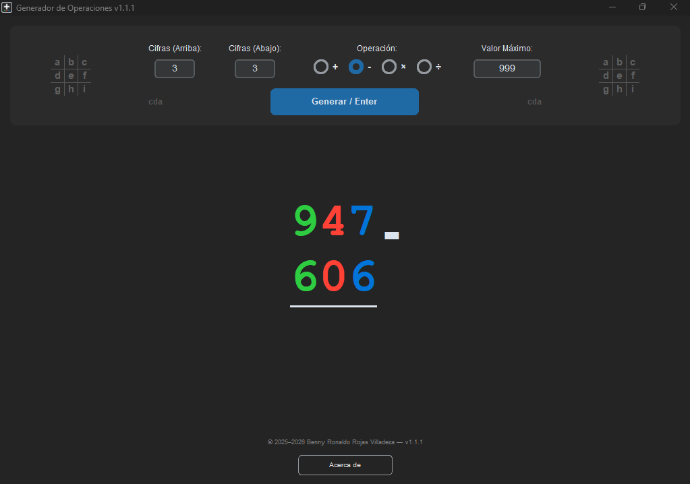
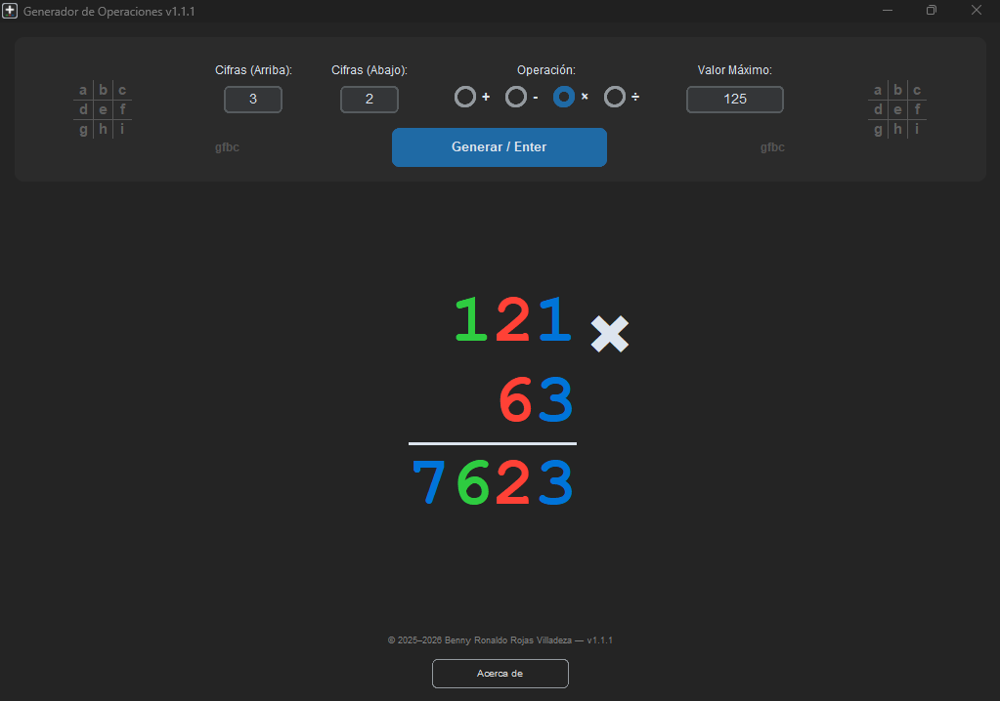

# Generador de Operaciones

Genera sumas, restas, multiplicaciones y divisiones exactas, en formato vertical, para proyectarlas en pantalla grande.

Se creó y utilizó en un taller de cálculo con personas adultas sin educación básica previa, como apoyo específico para el momento de práctica de operaciones dentro de un proceso más amplio. Cubrió la necesidad de proyectar ejercicios nuevos al instante para que varias personas participaran sin depender de escribir cada operación en la pizarra, ajustando la dificultad según las cifras y el valor máximo trabajados.



## Uso

- **Cifras (arriba / abajo):** cuántas cifras tiene cada número (por defecto, 2 y 2). Un número de una cifra puede ser 0.
- **Operación:** suma, resta, multiplicación o división. La resta nunca da resultado negativo y la división siempre es exacta.
- **Valor máximo:** tope de los números (por defecto, 99). Se ajusta a las cifras elegidas: con 2 cifras va de 10 a 99, y un valor menor dentro de ese rango, como 80, se respeta.
- **Generar / Enter:** el primer Enter muestra la operación con el resultado oculto; el segundo muestra el resultado.
- **Colores por posición:** unidades azul, decenas rojo, centenas verde; el ciclo se repite.
- **Letras:** junto al botón aparece el resultado en letras (1 = a … 9 = i; el 0 se marca con `?`), y a los lados hay una cuadrícula de 3×3 con esas letras, para que quien facilita conozca el resultado de antemano y pueda orientar al participante.
- **Zoom:** rueda del ratón para agrandar o reducir el texto (tamaño inicial 72).

La operación no se desplaza entre un ejercicio y otro mientras no cambies las cifras, el valor máximo o la operación.



**Privacidad:** el programa funciona sin conexión y no guarda ni envía datos de quienes participan.

## Instalación y ejecución

Pensado para Windows. Requiere Python 3.10 o superior para ejecutarlo desde el código.

```bash
git clone https://github.com/begsbenny/generador-operaciones.git
cd generador-operaciones
python -m venv .venv
.venv\Scripts\activate
pip install -e ".[dev]"
python run.py                   # o: python -m operaciones
```

## Tests

```bash
pytest
```

## Generar el ejecutable (Windows)

PyInstaller crea el ejecutable del sistema operativo donde se ejecuta, por eso debe hacerse en Windows:

```bash
python scripts/build_exe.py             # un solo archivo: dist/GeneradorOperaciones.exe
python scripts/build_exe.py --carpeta   # carpeta dist/GeneradorOperaciones/ (abre más rápido)
```

El script incluye el icono y los recursos, y copia `LICENSE` y `THIRD_PARTY_NOTICES.md` junto al ejecutable.
Si compartes el ejecutable, entrégalo con esos dos archivos. Los ejecutables sin firma digital pueden
provocar el aviso de Windows SmartScreen o de algunos antivirus; es habitual en programas hechos con PyInstaller.

## Estructura

```
src/operaciones/
├── __init__.py   Versión, autor y fecha
├── config.py     Constantes, colores, tema y valores por defecto
├── logic.py      Generación de operaciones e interpretación de los campos (Python puro)
├── gui.py        Clase OperacionesApp (CustomTkinter)
├── recursos.py   Carga del icono
├── __main__.py   Arranque
└── assets/       Icono
docs/             Capturas de pantalla
tests/            Pruebas
scripts/          build_exe.py
run.py            Lanzador (desarrollo y PyInstaller)
CHANGELOG.md · LICENSE · THIRD_PARTY_NOTICES.md · AGENTS.md
```

## Licencia

Código publicado bajo licencia [MIT](LICENSE). Los iconos son obra de este proyecto y llevan la misma licencia.
Las bibliotecas de terceros que usa están en [THIRD_PARTY_NOTICES.md](THIRD_PARTY_NOTICES.md).

Se ofrece «tal cual» y sin garantías (ver `LICENSE`). Es una herramienta de apoyo didáctico; no es un servicio
ni un dispositivo de salud.

## Autor

Benny Ronaldo Rojas Villadeza
